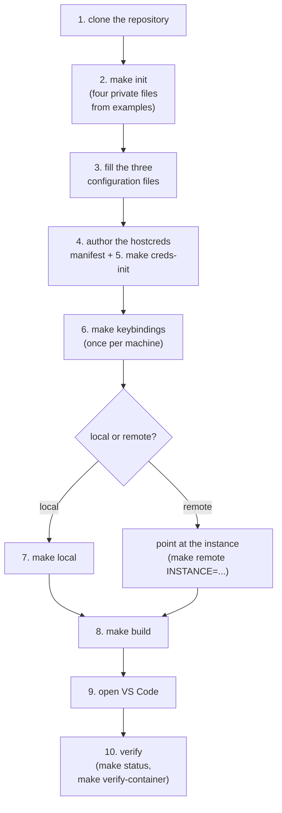

# Environment setup runbook

This runbook is the ordered sequence a fresh machine follows from nothing to a verified devcontainer, with a verification step after each stage. It is written so that neither a new developer nor an AI agent needs tribal knowledge:

- Every command is stated.
- Every check says what success looks like.
- Every failure names its own remedy.
- Nothing here asks you to improvise.

This runbook expands the README's local quick start into full detail. The reference material it points at rather than repeats:

- [environment-files.md](environment-files.md): what each private file and every value in it is.
- [devcontainer.md](devcontainer.md): how the container is defined, provisioned and supplied with credentials.
- The [remote-docker README](../.devcontainer/remote-docker/README.md): the EC2 engine itself.

One principle runs through the whole sequence: everything below runs on the host, the Mac.

- The container never resolves a credential, never reads the keychain, never runs an AWS login of its own.
- Each value moves once, from the place only this machine holds it into the container.
- The container's shell startup does the rest.

## The whole sequence at a glance



Which branch to take:

> **Do I need the remote half at all?**
> Only if work should survive the laptop sleeping, being offline, or being
> a different laptop. The local engine alone covers everything else, and
> the two run side by side later: switching is `make local` /
> `make remote INSTANCE=<name>`, and `ENGINE=` addresses either without
> switching. See "Working with several engines at once" below.

## Prerequisites

The tooling is macOS-first: the keychain credential source, the OrbStack context name and `make keybindings` all assume it.

- Install and verify each tool before moving on.
- A missing tool fails later with the same install command, but earlier is cheaper.

| Tool | Install | Verify |
|---|---|---|
| macOS | (the machine you are setting up) | `uname -s` prints `Darwin` |
| Docker engine + CLI (OrbStack) | `brew install orbstack` | `docker info` reports a running engine |
| VS Code + `code` command | `brew install --cask visual-studio-code`, then Command Palette → "Shell Command: Install 'code' command in PATH" | `code --version` prints three lines |
| git | `xcode-select --install` | `git --version` |
| uv | `brew install uv` | `uv --version` |
| zsh | ships with macOS | `zsh --version` |
| aws CLI v2 | `brew install awscli` | `aws --version` prints `aws-cli/2…` |
| azure CLI | `brew install azure-cli` | `az version` prints a version and a set of module versions |
| gh | `brew install gh`, then `gh auth login` | `gh auth status` reports a login |
| devcontainer CLI | `npm install -g @devcontainers/cli` | `devcontainer --version` |
| jq | `brew install jq` | `jq --version` |

Two of those need one more step beyond installation:

- The aws CLI needs a profile you can log into, because the `aws-export` credential source resolves through the host's own session: `aws sso login --profile <profile>` must succeed for every profile an `aws-export` manifest entry will name.
- gh needs its login because the `git` credential source resolves through git's credential helper on this machine, and `gh auth login` is what feeds that helper for github.com.

The azure CLI row is needed only when azure engines are in play; a machine that never targets one never runs it.

- `az login` must succeed before an azure engine is provisioned or connected to, because the relay token the forward presents and the state store's subscription lookup both resolve through that login.

Verify: every row's command above answers without an error.

## 1. Clone the repository

```sh
git clone <this repository's URL>
cd general-dev
```

Verify: `git status` names the branch and reports a clean tree.

## 2. Create the private files

`make init` copies four gitignored files from their committed examples, never overwriting a file that already exists:

- `shell.env`
- `devcontainer-environment-variables.json`
- `.devcontainer/aws-profile-map.json`
- `.devcontainer/hostcreds.map.json`

The first three hold identity and configuration; the fourth is the hostcreds manifest, the one list of credentials this machine pushes.

- All four are private on purpose, since they name you and your accounts.
- That is why `make init` copies them from examples instead of the repository shipping them directly.

Verify: `make init` prints `created` for each of the four, then lists the placeholders still to replace.

Verify: a second run prints `already exists, left untouched` for every file, which is the idempotence check.

## 3. Fill the three configuration files

Replace every `<PLACEHOLDER>` in the three configuration files:

- `shell.env`: git identity, default branch, proxy settings.
- `devcontainer-environment-variables.json`: the template input.
- `.devcontainer/aws-profile-map.json`: your SSO profiles.

What each value does, ready-made prompts for delegating the filling to Claude, and the macOS / Linux / WSL differences are all in [environment-files.md](environment-files.md).

Verify: run `make init` again. It scans all four files and ends with `[DONE] no placeholders left`, or it lists exactly which placeholders remain, per file, until then.

## 4. Author the hostcreds manifest

`.devcontainer/hostcreds.map.json` (created in step 2 from its example) is a JSON object mapping a credential name to its source.

- No value is ever written into the manifest.
- The manifest names where each value lives, and the push resolves it.

The committed example shows one entry per source:

```json
{
  "EXAMPLE_API_TOKEN": {
    "source": "keychain"
  },
  "GIT_GITHUB": {
    "source": "git",
    "host": "github.com"
  },
  "AWS_DEFAULT": {
    "source": "aws-export",
    "profile": "default"
  }
}
```

What each source does:

- `keychain`: a value stored in the macOS keychain.
  - By default the item is addressed as service `devcontainer/<project>/<NAME>`, where `<project>` is the checkout directory's name, so one project's items cannot collide with another's.
  - Optional `service` and `account` labels override that default for a credential that already lives somewhere else.
  - In the container the credential is exported under its manifest name.
  - Store the item with `make creds-init` in the next step.
- `git`: the password git's own credential helper holds for the bare hostname in its required `host` label (`gh auth login` feeds that helper for github.com).
  - Inside the container it seeds `~/.git-credentials` and exports no variable.
  - Git reads it through its own helper; copying it into the environment would only widen its exposure.
- `aws-export`: the session credentials `aws configure export-credentials` prints on this machine, for the optional `profile` label's profile (`default` when unset).
  - In the container it becomes the three standard AWS variables, so every SDK and the aws CLI pick the session up.
  - It expires with the session; a fragment past expiry exports nothing and says so (see Troubleshooting).

Credential naming:

- A credential name must match `[A-Z][A-Z0-9_]*`, an uppercase letter followed by uppercase letters, digits or underscores, because the name becomes both a shell variable and a `<NAME>.env` fragment filename.
- Reserved names are refused outright: `PATH`, `LD_PRELOAD`, `DYLD_INSERT_LIBRARIES`, `AWS_ACCESS_KEY_ID`, `AWS_SECRET_ACCESS_KEY` and `AWS_SESSION_TOKEN`, each of which would silently shadow a real variable at shell startup.

The one entry this repository's committed configuration expects is `ZAI_API_KEY` from the keychain: the opencode config interpolates `{env:ZAI_API_KEY}`, and without that entry opencode in the container authenticates with nothing.

The full schema, defaults and the scanner integration are in [environment-files.md](environment-files.md)'s "Host credentials (hostcreds)" section.

Verify (validates the whole manifest fail-fast, no container needed):

```sh
PYTHONPATH=.claude/plugins/devcontainer/scripts \
  python3 -m devcontainer_config.cli creds-fragments --print-git-hosts
```

Success prints the git-source hostnames, one per line, and nothing else.

Verify: a malformed manifest exits non-zero listing every problem in the file at once, each naming its entry.

## 5. Store the keychain items

```sh
make creds-init
```

- Prompts once per keychain credential the manifest names whose item does not exist yet, then stores it; the prompt shows the keychain service it will store under, and typed input is not echoed.
- Items that already exist are reported as `already present` and not re-asked.
- The value rides stdin into `security -i`, never a command-line argument, because an argument reaches the process table where any other user of this machine can read it.

The automation path feeds exactly one named credential from stdin, with the value never appearing in the command line:

```sh
printf '%s' "$ZAI_API_KEY" | make creds-init CREDS_INIT_ARGS='--stdin ZAI_API_KEY'
```

One trailing newline is stripped; an empty value, or one containing a line break, is an error rather than a stored credential.

Verify: the command prints `stored: <names>` and/or `already present: <names>` and exits 0.

## 6. Bind Shift+Enter (once per machine)

```sh
make keybindings
```

- Makes Shift+Enter insert a newline in every VS Code terminal, which Claude Code and opencode prompts need.
- It must run on the host because the VS Code window resolves keybindings where it runs, not inside the container; reload the window afterwards.
- Running `/terminal-setup` from a container terminal writes the binding where no VS Code process reads it, which is why it appears to do nothing.

Verify: in a VS Code terminal, Shift+Enter inserts a newline instead of submitting the current prompt.

## 7. Point at the local engine

```sh
make local
```

Switches the active docker context to the local engine (`LOCAL_DOCKER_CONTEXT` from `.devcontainer/remote-docker/config.env`, `orbstack` by default).

Nothing remote is stopped.

Verify: `docker context show` prints the local context name.

## 8. Build the container

```sh
make build
```

- Builds the image, runs postCreate, and, as its last step, pushes every credential the manifest names.
- The push resolves each entry on this machine, writes one `<NAME>.env` fragment per credential into `~/.hostcreds/` inside the container (directory mode 700, fragments mode 600), seeds `~/.git-credentials` for git-source entries, and proves the git credential with `git ls-remote origin` before reporting success.
- The build refuses to start if a container for this project already exists on the engine (`make rebuild` replaces one deliberately), and blocks, exit code and all, until the container is actually up.

A rebuild wipes the credentials by design: `~/.hostcreds` lives in the container's own filesystem, not a volume, so a rebuilt container starts with none.

- The build that created it has already pushed a fresh set.
- There is nothing to restore by hand, ever.

Verify: the command exits 0 after printing `pushed <N> credential fragment(s) into ~/.hostcreds` and `container is up`.

Verify: `make status` shows one container, running, for this project.

## 9. Open VS Code

```sh
make reopen
```

Seeds the VS Code server the window will need (so the first attach does not transfer ~200 MiB over the connection) and opens the workspace attached to the container.

Verify: the window opens on `/workspaces/<project>` and a terminal lands in the shared tmux session.

Verify: `echo $DEVCONTAINER` prints `true`.

## 10. Verify the container

```sh
make verify-container
```

Re-checks the pushed credentials inside the container, printing one PASS line per check.

- The checks: the store directory at mode 700; every fragment at mode 600; the hostcreds startup block present in both `~/.bashrc` and `~/.zshenv`; a shell startup that prints no hostcreds error; `git ls-remote` when the manifest names a git-source entry; `aws sts get-caller-identity` when it names an aws-export one.
- Any FAIL names its check and the exit code is non-zero.
- There is no check whose failure is silent.

Verify: every line prints PASS and the command exits 0.

At this point the environment is complete.

Day to day:

| Goal | Do this |
|---|---|
| A shell inside the container | `make exec` |
| What state is anything in | `make status` (read-only, the active engine), `make list-containers` (every engine at once) |
| Pause / resume the container | `make stop`, `make start` (the checkout survives either) |
| Refresh pushed credentials after a rotation or an SSO re-login | `make push-creds` (`make up` does it too, plus its own engine checks) |
| Rebuild from scratch | `make rebuild` (credentials re-push automatically, see step 8) |

## Pointing at the remote engine instead

Steps 1 through 6 are unchanged: the manifest, the keychain items and the keybinding are properties of this machine, not of either engine.

From step 7 on, the remote route has a lifecycle of its own, described below.

- The certificate material's reference half is [devcontainer.md](devcontainer.md)'s "Certificate lifecycle" section.
- The per-instance deployment file's contract is [remote-instances/README.md](../remote-instances/README.md).
- The credential push needs no remote variant at all: it rides whichever docker context the run addresses, so the very same `make push-creds` and `make build` steps deliver the same fragments to a remote engine's container, whichever kind it is.

### The lifecycle at a glance

One remote engine per project under `remote-instances/`; the instance name is the project name (e.g. `acme`).

The `make help` INSTANCES group drives every stage:

| Stage | Command | What it does |
|---|---|---|
| Scaffold (no EC2 exists yet) | `make instance-init INSTANCE=<project>` | Writes `remote-instances/<project>/terragrunt.hcl`; never deploys |
| Edit the deployment | edit the file `instance-init` wrote | Instance type, volume sizes, availability zone, tags, AMI |
| Provision and converge | `make instance-deploy INSTANCE=<project>` | Terragrunt apply, id link, trust chain where missing, secret push |
| Open the forward | `make remote INSTANCE=<project>` | Opens the SSM forward as a background daemon, points docker at the engine; returns once docker answers through it |
| Build and open | `make build INSTANCE=<project>`, then `make reopen INSTANCE=<project>` | Clone into a volume on the engine, build, run postCreate, attach VS Code |
| Day to day | `make status`, `stop`, `start`, `exec` with `INSTANCE=<project>`; `make list-containers` for the every-engine view | Container lifecycle; the checkout survives all of it |
| Pause to save cost | `make instance-stop INSTANCE=<project>`, later `make instance-start INSTANCE=<project>` | Stops and starts the instance's VM (the EC2 one here); containers, volumes and checkouts survive |
| Retire | `make instance-destroy INSTANCE=<project>` | Terragrunt destroy plus cleanup of parameters (EC2), certificates, context and id |

- `make list-instances` reports every configured instance's live state at any point: EC2 state, recorded id, Parameter Store and certificate material, forwarded port, docker context.
- The probes are kind-aware.
- An ssh engine (one declared by a `remote-instances/<name>/engine.json` manifest; see the ssh transport in devcontainer.md) runs no EC2 probe at all and answers one reachability probe instead, rendered in the same STATE column as `ok` or `unreachable`.
- An azure engine answers with its VM power state and its Key Vault TLS material, the record's VM name standing in for the EC2 id, with the probes its kind does not have dashed.
- `make instance-status INSTANCE=<name>` narrows the report to one instance.
- The targets that accept `INSTANCE=<name>` also take `ALL=1` for every configured instance at once.

The container side mirrors both shapes.

- `make list-containers` sweeps every engine (the local one plus every configured instance's) and reports one row per container this project's label owns, with per-engine reachability.
- An engine that cannot answer names itself and the sweep keeps going; the exit code says whether every engine answered.
- The lifecycle targets take `ALL=1` for the fleet form, one engine after the other, fail-fast on the first that cannot answer; `make clean ALL=1` additionally requires `CONFIRM=destroy`.
- `make build NAME=x` (or `make up NAME=x`) names the container at creation instead of leaving the `<repo>-<devcontainerId>` default for a later `make rename`.

### The ssh engine path

- An EC2 instance is one kind of remote engine.
- The other kind is any machine reachable over SSH that runs Docker: a Linux daemon through its socket or a TCP endpoint, or Windows through Docker Desktop's exposed TCP endpoint.
- The whole engine is one `remote-instances/<name>/engine.json` manifest.
- No AWS value exists behind it anywhere: no Terragrunt deployment, no state bucket, no Parameter Store prefix, no certificates, no instance role.
- The ssh transport in [devcontainer.md](devcontainer.md)'s "Transport" section carries the docker API to it over a managed ssh local forward instead of an SSM session.

The lifecycle is five targets:

| Stage | Command |
|---|---|
| Scaffold the manifest | `make engine-init INSTANCE=<name> HOST=<host> USER=<user>` (`PORT=` and `DOCKER_ADDR=` optional; a Windows engine needs Docker Desktop exposed and `DOCKER_ADDR=tcp://localhost:2375`) |
| Prove reachability | `make engine-verify INSTANCE=<name>`: opens the forward, handshakes docker through its context, closes the forward, prints the versions |
| Open the forward | `make remote INSTANCE=<name>` (or `make connect-start INSTANCE=<name>`, which leaves the machine-wide context alone); the engine's own kind selects the transport, so an ssh engine needs no variable. An explicit `DEVCONTAINER_TRANSPORT` that contradicts the kind is refused naming the conflict |
| Build | `make build INSTANCE=<name>` |
| Retire | `make engine-remove INSTANCE=<name> CONFIRM=remove`, refused while a project container still exists on the engine |

- Configuration reaches such an engine's container through the volume, not Parameter Store: the build seeds the same transformed payload the EC2 path publishes straight into the freshly cloned workspace (fresh on every rebuild).
- `make push-secrets` refreshes the two files in the running container over stdin, so a config change needs no rebuild.
- Both channels and their guarantees are in [devcontainer.md](devcontainer.md)'s "Secrets model" section.
- `gd-engine-ssh` drives this whole path for an agent.

### The Azure engine path

- An EC2 instance is one provisioned kind of remote engine.
- The other provisioned kind is an Azure virtual machine.
- Like the EC2 kind, this repository provisions it through Terragrunt, but against a different cloud and a different transport.
- The deployment creates the resource group, the virtual network and subnet, the platform unit (a zero-inbound network security group, a user-assigned managed identity, the instance's Key Vault, and the relay namespace and hybrid connection), and the VM itself with its root and data disks.
- The instance carries no public IP and no SSH surface anywhere: the docker API travels over the relay hybrid connection, whose listener end is a unit on the VM dialing *outward* to the relay service, and whose sender half is the laptop's forward, authorized by Entra and carrying the same mTLS docker API.
- State storage is one Azure storage account per instance behind the azurerm backend, ensured on the first Terragrunt run: the azure counterpart of the per-instance S3 bucket.

The lifecycle is the same targets the EC2 kind uses, selected by `CLOUD=azure` at scaffold time:

| Stage | Command |
|---|---|
| Scaffold the deployment | `make instance-init INSTANCE=<name> CLOUD=azure LOCATION=<location>` (`VM_SIZE=` optional; `REGION=` and `AMI=` are EC2-only inputs and refused on azure) |
| Edit the deployment | edit the file `instance-init` wrote: VM size, volume sizes, CIDR blocks, tags; also add your Entra object id to `relay_sender_object_ids` and `keyvault_officer_object_ids` |
| Provision and converge | `make instance-deploy INSTANCE=<name>`: Terragrunt apply; provisions the platform unit and VM, carries your two object-id grants in as role assignments on the namespace and the vault, records the relay address record, pushes secrets |
| Open the forward | `make remote INSTANCE=<name>` (or `make connect-start INSTANCE=<name>`, which leaves the machine-wide context alone); the engine's own kind selects the relay transport, so an azure engine needs no variable |
| Build and open | `make build INSTANCE=<name>`, then `make reopen INSTANCE=<name>` |
| Pause to save cost | `make instance-stop INSTANCE=<name>`, later `make instance-start INSTANCE=<name>` (deallocate and restart the VM; containers, volumes and checkouts survive) |
| Retire | `make instance-destroy INSTANCE=<name>`: Terragrunt destroy plus cleanup of the local record, context and certificates; the state store survives, like the EC2 bucket |

The object-id edit is the one input an azure scaffold cannot fill in for you, because it names you:

- `relay_sender_object_ids` grants your Entra identity the Relay Sender role on the namespace: the right to open the sender half of the hybrid connection the forward rides.
- `keyvault_officer_object_ids` grants Key Vault Secrets Officer on the vault: the right to publish the instance's TLS material and secrets into it.
- An empty list provisions fine and simply leaves the connect and the push with no grant to stand on.
- Find your id with `az ad signed-in-user show --query id`.

The connect flow differs from the SSM one in two ways worth knowing:

- The VM-side listener stops itself when idle (Azure bills listener-hours while a hybrid connection has a connected listener), so opening the forward first starts it again with one `az vm run-command invoke`.
- On a freshly started VM that cold start can take tens of seconds; the connect flow waits behind it deliberately rather than letting the first docker call die.
- The sender's credential is an Entra token rather than an AWS SSO session, and it lives roughly an hour.
- A 401 partway through a workday is remedied the same way the SSO expiry is: `az login`, then `make connect-refresh INSTANCE=<name>` re-opens the forward from its recorded command.
- `gd-env-setup-azure` drives this whole path for an agent.

### What scaffold and deploy do

- `make instance-init INSTANCE=<name>` writes the one file a new instance requires, `remote-instances/<name>/terragrunt.hcl`, from a template carrying the default sizing and a freshly allocated CIDR block, then prints the commonly edited inputs.
- It never runs Terragrunt.
- The scaffold stays local to this checkout: `instance-init` also appends `remote-instances/<name>/` to the repository `.gitignore`, so the directory never appears in `git status`.
- To track a deployment deliberately, delete that appended line and commit the directory.
- On the EC2 kind, `instance-init`'s `REGION=` option selects only where the default AMI and availability zone are looked up; the deployment region is `REMOTE_AWS_REGION`, which every Terragrunt-running target requires with no default.
- On the azure kind, `REGION=` is refused and the deployment's placement is the `LOCATION=` the scaffold carries as an input; no `REMOTE_AWS_REGION` is demanded of azure commands.

- `make instance-deploy INSTANCE=<name>` converges the instance: terragrunt init (bootstrapping the EC2 instance's state bucket on the very first run, or ensuring the azure instance's state storage account), validate, a plan guarded against accidental replacement, apply of exactly the guarded plan, then follow-ups.
- The follow-ups run only when a status probe reports the corresponding piece missing: recording the applied address (the EC2 id, or the azure engine-address record written from the terragrunt outputs), issuing and publishing the certificate material, and pushing secrets.
- When the material is already present, the steps are skipped entirely, so a deploy never restarts a live daemon; renewals are manual, via `make cert-status`.
- The replacement guard is the safety net worth knowing: a plan that would replace or destroy resources is refused unless `CONFIRM=replace` is set, naming the offending plan lines (see Troubleshooting).

### Why mutual TLS, and what the certificates are for

- Two independent factors stack up between this machine and the docker daemon, each answering a different question.
- On the EC2 kind, IAM authorizes the SSM session: the `ssm:StartSession` grant decides who may open the port forward at all, and removing it is the only revocation mechanism the platform has.
- On the azure kind, Entra authorizes the sender half the same way: the Azure Relay Sender role decides who may couple to the hybrid connection at all, and removing it, or deleting the hybrid connection, is that kind's revocation mechanism.
- The certificates then authenticate the docker API itself, in both directions, on top of that forward: the daemon presents a server certificate the client verifies, and the client presents a certificate the daemon verifies against the CA it holds.
- Neither factor substitutes for the other.
- A valid SSO or Entra identity alone commands nothing, and a copied client certificate is inert without a forward the cloud authorizes.

- Certificate material lives per instance under `~/.docker/certs/<name>/` (or `$DOCKER_CONFIG/certs/<name>/`).
- The same directory holds the instance's recorded EC2 id: an `instance-id` file written by `make instance-link` and, automatically, by `make instance-deploy`, read by every remote target's resolver, so no id variable is ever set by hand, and an id dies with its instance.
- `make cert-status` reports client and CA expiry per instance, for the remote engines only: EC2 and azure both carry TLS material locally, and an ssh engine has none, so only an ssh engine is refused.
- A renewal is a deliberate, manual step and touches nothing on the running instance, because the daemon accepts any client certificate that chains to its CA.

### Stop, start and destroy

- `make instance-stop INSTANCE=<name>` stops the instance's VM and waits until its platform reports it down (EC2 `stopped`, azure `PowerState/deallocated`).
- `make instance-start INSTANCE=<name>` starts it again and waits for its engine agent to report ready (the EC2 SSM agent's `Online`, or the azure VM agent's `Ready`).
- Everything on the instance survives the cycle: containers, images, volumes, the cloned checkouts.
- The port forward does not survive it; open the forward again after a start with `make remote INSTANCE=<name>`.
- If connecting then still fails, reinstall the daemon's TLS material with `make cert-install INSTANCE=<name>`.

- `make instance-destroy INSTANCE=<name>` runs terragrunt destroy for that instance, then cleans up everything Terragrunt does not know about: for an EC2 instance its Parameter Store parameters, for both kinds its docker context and its certificate directory (the recorded id file included; on azure the same directory carries the engine-address record).
- `ALL=1` destroys every configured instance, and only that form requires `CONFIRM=destroy`, because a typo'd ALL should never be all it takes to end the fleet.

- Each instance owns its remote-state store, and it stands outside that instance's lifecycle: one store per instance, named from `remote-instances/root.hcl`'s own template and a committed suffix.
- The EC2 kind's S3 bucket is `tg-state-<instance-name>-<region>-<account-id>-<suffix>`.
- The azure kind's storage account composes its lowercase-alphanumeric form from the same per-instance naming idea, holding a `tfstate` blob container in a dedicated `rg-<instance>-state` resource group.
- No destroy target deletes it; two targets manage the stores instead, per kind.
- `make bucket-list` shows every store the fleet's template matches and marks the ones a configured instance owns.
- `make bucket-delete INSTANCE=<name>` purges and deletes one; `ALL=1` deletes every store in the fleet and additionally requires `CONFIRM=delete`, because it takes every instance's state history with it.
- The surfaces are per kind: an all-EC2 fleet answers to the aws CLI and needs `REMOTE_AWS_REGION`; an all-azure fleet answers to the az CLI.
- A fleet mixing the two kinds is refused naming them, so the per-kind forms run on a fleet configured for one kind at a time.

### Working with several engines at once

- Every instance's port forward is its own: each instance's docker context records an allocated local port, so forwards for several instances coexist alongside the laptop's own engine without colliding.
- That is what makes the `ENGINE` variable work.
- `ENGINE` addresses one engine explicitly instead of following the machine-wide active docker context, so parallel terminals can drive different engines concurrently without any of them switching the context the others share.

`ENGINE=local` names this machine's engine; any other value names an instance under `remote-instances/`.

Both spellings below are the same command:

```sh
make status ENGINE=acme
ENGINE=acme make status
```

- Unset, every target behaves as before and follows the active context.
- Set, every docker call the target makes is aimed at the engine it names: one terminal can run `make build ENGINE=local` while another runs `make build ENGINE=acme`, and a third drives a second instance.
- Each remote engine needs its forward open first: `make remote INSTANCE=<name>` opens it as a background daemon and returns once docker answers through it (the engine's own kind picks the transport, per the ssh engine path above, so an ssh engine needs no variable).
- Later, `make connect-start ENGINE=<name>` re-opens a single forward without touching what other terminals see.
- The forward daemon's lifecycle has its own targets: `make connect-status INSTANCE=<name>` (or `ALL=1`) reports pid, port and whether the tunnel answers; `make connect-stop` closes one or every forward; `make connect-refresh` stops and reopens from the recorded command when an SSO session expires or a tunnel drops; `make connect-list` shows the roster.
- `make list-instances` shows the forward port each instance's context records.

- VS Code is per engine by attachment, not by switching: a window attaches to the container it was opened against, wherever that container lives.
- Run one window per engine and attach each to the container on that engine; `ENGINE` changes what `make` addresses, never what an open window talks to.

- Three targets refuse under `ENGINE` with exit code 2: `make local`, `make disconnect` and `make remote`.
- They switch the machine-wide docker context, which is exactly what `ENGINE` exists to avoid: under it, every call is already aimed at the named engine and nothing needs switching.
- For the same reason, a run that names two different engines (`INSTANCE=a ENGINE=b`) is refused before any work happens.

## Agent skills

- The steps above reach a human through make; the same surface reaches an AI agent through the `gd-` skill roster shipped in this checkout.
- Every skill lives in one canonical place, `.agents/skills/<name>/SKILL.md`, prefixed `gd-` so the names are agent-agnostic.
- Every skill drives the same targets this runbook states, asking for what it needs, verifying each step, and refusing to guess.
- The roster, its families and its coverage guarantee are [skills.md](skills.md).

Inside this checkout both supported agents already see the roster, with nothing to install: opencode reads `.agents/skills` natively, and Claude Code reads it through the plugin's tracked `skills/` symlink.

To reach the roster from an agent launched outside this checkout, wire it once on this Mac:

```sh
make skills-install                            # both agents, global scope
make skills-install AGENT=opencode             # opencode only
make skills-install AGENT=claude SCOPE=global  # Claude Code, global scope
```

- `SCOPE=global` (the default) creates one symlink named `general-dev-skills` in the agent's user-level skill directory, pointing at this checkout.
- `make skills-remove` deletes only a link resolving inside this repository, so your personal skills are never touched.
- `make skills-list` reports the state per agent and scope.
- The project and runtime scopes are described with the full AGENT x SCOPE matrix in [skills.md](skills.md)'s "Installing for agents" section.

## Troubleshooting

- **Ruff or Python logs `spawn .venv/bin/python ENOENT`.**
  - Symptom: the container's Ruff log shows the error and falls back to its bundled binary.
  - Cause: a host-OS virtual environment created inside the workspace. The directory is bind-mounted into the Linux container as-is, and the extensions resolve `.venv/bin/python`, whose symlinks point at the macOS Python.
  - The repository's Makefile already redirects uv's project environment outside the workspace (`UV_PROJECT_ENVIRONMENT` in the Makefile), so this only happens after a bare `uv run` in the repository root.
  - Fix: delete the `.venv` directory and run the work through the Makefile (for example `make test`) instead of a bare `uv run`.

- **An AWS credential expired.**
  - Symptom: opening a shell prints `notice: <NAME> expired; refresh with: make push-creds` on stderr, and the AWS variables are absent from that shell.
  - The fragment's guard exports nothing past expiry rather than exporting stale values.
  - Fix: re-login the host's session if it lapsed (`aws sso login --profile <profile>`), then run `make push-creds`, or `make up`, which pushes as part of its normal work, and open a new shell.

- **A keychain item is missing.**
  - Symptom: `make build` or `make push-creds` aborts with `cannot resolve <NAME> from the keychain source`, naming the keychain service and the command that failed.
  - Because the push is the build's last step, the container is otherwise complete and no rebuild is needed.
  - Fix: `make creds-init` stores the item (the error message says so), then re-run `make push-creds`.
  - An item that exists with an empty password counts as missing; creds-init stores over it.

- **The scanner blocked a commit.**
  - Symptom: pre-commit (or `make lint-secrets`) fails with a finding naming a hostcreds credential.
  - `make lint-secrets` compares every scanned line against the real values resolved from this machine's manifest, so a pasted fragment or an accidentally committed value is caught even when it matches no generic pattern.
  - The finding never prints the value.
  - Fix: remove the value from what is being committed; it already lives in the keychain and travels by push, so nothing needs it in git.
  - There is no ignore list and no suppression annotation: a finding is either real, and fixed, or a suspected false positive requiring human review.

- **A deploy refuses with "this plan replaces or destroys resources".**
  - Symptom: `make instance-deploy INSTANCE=<name>` stops before applying and prints the offending plan lines (`must be replaced`, or a `Plan:` line counting resources to destroy).
  - Cause: an edit to the per-instance file forces Terraform to replace a resource that exists.
  - What dies if you proceed: the current EC2 instance and its volumes, and with them every container on that engine and the cloned checkout in its volume; unpushed work goes with it.
  - Deploy converges the fresh instance it creates, but it cannot bring data back.
  - Fix: push anything worth keeping from the container first (`make exec`), then re-run deliberately with `make instance-deploy INSTANCE=<name> CONFIRM=replace`.
  - A plan that only changes resources in place never reaches this guard.

- **`make instance-destroy ALL=1` refuses.**
  - Symptom: exit 1 with "ALL=1 destroys every configured instance; confirm it".
  - Cause: the fleet-wide form destroys every instance under `remote-instances/` and demands an explicit confirmation for exactly that reason.
  - Fix: if a fleet teardown is meant, `make instance-destroy ALL=1 CONFIRM=destroy`; to end one instance, `make instance-destroy INSTANCE=<name>`, which needs no confirmation.

- **A remote target reports the engine unreachable, or no recorded id.**
  - Symptom: `make connect-start` or any docker call against the remote context fails with a connection diagnosis, or names a missing recorded id.
  - Cause: the SSM port forward is not open. It lives in the terminal that ran `make remote INSTANCE=<name>` and dies when that terminal is interrupted, when the laptop sleeps, or when the SSO session lapses.
  - Fix: open or refresh the forward for that instance (`make remote INSTANCE=<name>`, after `aws sso login --profile <profile>` if the session expired), then retry.
  - If the failure instead names a missing recorded id, record it with `make instance-link INSTANCE=<name> INSTANCE_ID=<id>`, or re-run `make instance-deploy INSTANCE=<name>`, which records the id automatically.
  - `make list-instances` shows the forward port each instance's context records.

- **An azure connect fails with 401.**
  - Symptom: `make connect-start INSTANCE=<name>` against an azure engine prints an authorization refusal naming the relay and a 401.
  - Cause: the Entra token the sender presents has expired; it lives roughly an hour.
  - Fix: `az login`, then `make connect-refresh INSTANCE=<name>`, which re-opens the forward from its recorded command with a fresh token.

- **The azure relay answers 404, no listener.**
  - Symptom: a connect or a docker call against an azure engine fails naming the hybrid connection and 404.
  - Cause: the VM-side listener is not running. It stops itself after an idle stretch, because azure bills listener-hours while a connected listener exists.
  - Fix: `make connect-start INSTANCE=<name>` starts the listener first (through one `az vm run-command invoke`), so run that rather than retrying whatever call surfaced the 404.
  - `make connect-refresh` alone re-runs a recorded command and does not start the unit.

- **The azure listener refuses to start.**
  - Symptom: the run-command that `make connect-start` issues returns and the unit still reports inactive.
  - Cause: something on the VM side (a stale unit, a package, an identity role) is keeping it down.
  - Fix: read why the unit is not active with the same channel the start used: `az vm run-command invoke -g <resource-group> --vm-name <vm-name> --command-id RunShellScript --scripts "journalctl -u gd-relay -n 50 --no-pager"`, then take the action its output names.
  - The resource group and VM name are in the instance's address record.

- **The azure VM is deallocated.**
  - Symptom: every azure probe dashes, or a connect names the VM stopped.
  - Cause: the instance was deallocated, deliberately with `make instance-stop` or by an idle policy on the subscription.
  - Fix: `make instance-start INSTANCE=<name>` starts the VM and waits until its agent reports ready, then `make remote INSTANCE=<name>` re-opens the forward.

- **The deploy dies in `SubscriptionNotFound` on a storage create.**
  - Symptom: `instance-deploy` fails while bootstrapping the state store, and the raw output is `(SubscriptionNotFound) Subscription <id> was not found.`
  - Cause: a fresh subscription has the resource providers unregistered, and azure's error for it surfaces here first.
  - Fix: register them, then re-run the deploy; the command block is in [azure-requirements.md](azure-requirements.md), section 2's once-per-subscription note.

- **The apply dies in a VM quota or SKU error.**
  - Symptom: `terragrunt apply` fails with `exceeding approved <family> Cores quota` (the subscription has a zero-core limit for that VM family) or `SkuNotAvailable` (the family has quota but the region has no capacity).
  - Cause: azure rations VM families per region, and a fresh subscription starts at zero for most of them.
  - Fix: pick a size whose family shows nonzero quota and no restriction (the check commands are in [azure-requirements.md](azure-requirements.md), section 2), then set `vm_size` (and `os_image_urn` for an x64 size) in the scaffolded `terragrunt.hcl` and re-run `make instance-deploy INSTANCE=<name>`.

- **A deploy fails with `Error acquiring the state lock`.**
  - Cause: a previous deploy was killed mid-plan and its Terragrunt state lock survived.
  - Fix: the failed plan's printed output names the lock id; run `cd remote-instances/<name> && terragrunt force-unlock <lock-id>` with it, then re-run the deploy.
